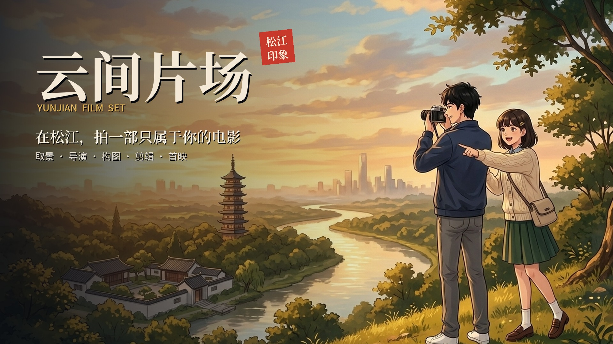

# 云间片场 · Yunjian Film Set

**在松江，拍一部只属于你的电影。**

## 在线试玩

👉 **[点击直接在线游玩](https://keaideppk.github.io/yunjian-film-set/)**

- 推荐使用电脑浏览器（Chrome / Edge）全屏游玩，单局约 10–15 分钟。
- 也可在 [Releases](https://github.com/keaideppk/yunjian-film-set/releases) 下载离线压缩包，解压后双击 `index.html` 即可离线运行。

## 游戏简介

“松江创世纪”2026 首届 AI 游戏创作创业大赛 · **松江印象赛道**参赛作品。

松江古称“云间”。你是松江大学城的学生导演，要在三天里跑遍**方塔园、醉白池、广富林遗址、泰晤士小镇、车墩影视基地、辰山矿坑花园**，拍出一部短片，送到上海科技影都首映。

- **情绪即玩法**：远景看取景地与时段（清晨/午后/黄昏/夜晚 + 晴/雨/雾），特写看演员表演，亲手拖动取景框按三分法构图并完成对焦。
- **剪辑语法**：把镜头排入 5 个情节拍，触发远景开场、首尾呼应、景别递进、松江巡礼等加成，支持实时试看与智能粗剪。
- **首映与海报**：影院大银幕放映并实时生成观众弹幕，按故事、画面、松江味评分颁发「金鲈奖」等奖项，并生成可下载的 1080×1620 PNG 电影海报。
- **三部原创剧本**：《云间来信》（青春爱情）、《方塔砖语》（悬疑寻宝）、《鲈乡味道》（温情喜剧）。
